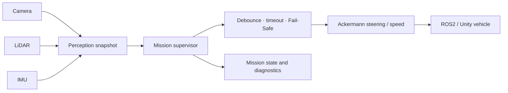
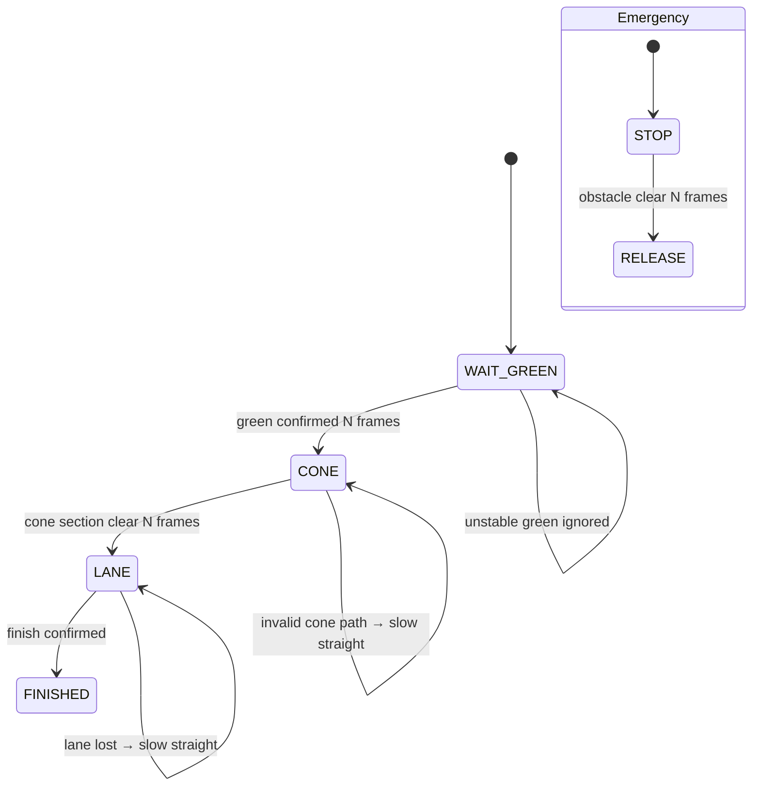

# 2026 Kookmin Autonomous Driving Competition — Mission Supervisor Reconstruction

[한국어](README.md) | [English](README.en.md)

> A hardware-independent reconstruction of mission-supervision concepts observed in the SKKU EMP team's preliminary autonomous-driving work. It does not contain the submitted ROS2 source or team calibration values.

| Item | Details |
|---|---|
| Status | Took part in the 2026 preliminary round (competition finished) |
| Original system | Camera/LiDAR/IMU → perception → mission planning → Ackermann control |
| Included code | Standard-library-only mission state machine and unit tests |
| Documented role | ROS2 setup, `track_drive.py` framework, sensor integration, final integration/debugging |
| Attribution limit | No Git or file/function authorship metadata in the source workspace |

## Quick Navigation

- [`src/mission_supervisor.py`](src/mission_supervisor.py): portable mission state machine
- [`tests/test_mission_supervisor.py`](tests/test_mission_supervisor.py): transition and fail-safe tests
- [`docs/provenance.md`](docs/provenance.md): evidence and unverified facts

## 1. Project Overview

The inspected local team material describes an ROS2/Unity driving pipeline that combines traffic-light start, cone course, lane following, pedestrian/obstacle response, school-zone limits, and mission transitions. Because the original workspace is not a Git repository and does not identify authors at file/function level, this repository contains a clean mission-supervisor reconstruction rather than copied team source.

## 2. System Architecture



### Reconstructed state machine



## 3. Mission Supervisor Behavior

| State | Normal behavior | Degraded/safety behavior |
|---|---|---|
| `WAIT_GREEN` | Start after consecutive green observations | Reset count on an unstable observation |
| `CONE` | Follow cone-path error with bounded steering | Slow straight motion when path is invalid |
| `LANE` | Follow lane error; cap speed in school zone | Slow straight motion when lane is lost |
| `FINISHED` | Command zero speed | Remain stopped |
| Emergency override | Takes priority over every mission | Release only after repeated clear observations |

## 4. My Contribution and Evidence

The team planning document assigns the single Electronic and Electrical Engineering member to:

- ROS2 environment setup
- the `track_drive.py` framework
- sensor-node integration
- final integration and debugging

No Git history links a name to files/functions, so these are not claimed as sole source contributions. The commit-backed personal artifact in this repository is the clean [`MissionSupervisor`](src/mission_supervisor.py) reconstruction and its tests.

## 5. Problems and Solutions

| Problem | Reconstruction approach | Test |
|---|---|---|
| One false frame could change missions | Consecutive-frame confirmation counter | Green debounce test |
| Immediate restart after an obstacle clears can be unsafe | Require repeated clear-distance observations | Emergency release debounce test |
| Temporary lane loss destabilizes steering | Zero steering with bounded slow speed | Lane-loss fallback test |
| School-zone and normal speed must differ | Observation-driven speed cap | School-zone speed test |
| Team source ownership is unclear | Standard-library-only clean reconstruction | Separate provenance documentation |

## 6. Run and Validate

```bash
python -m unittest discover -s tests -v
```

Tests cover consecutive green confirmation, lane-loss fallback, emergency-release debounce, and school-zone speed limiting.

## 7. Status

- Took part as a team in the preliminary (simulator) round of the 2026 Kookmin University Autonomous Driving Competition. The competition has finished.
- This repository does not reproduce or replace the submitted ROS2 package.

## 8. Repository Structure

```text
.
├─ src/
│  └─ mission_supervisor.py
├─ tests/
│  └─ test_mission_supervisor.py
├─ docs/
│  └─ provenance.md
├─ README.md
└─ README.en.md
```

## 9. Limitations and Exclusions

- Real perception, planning, control, ROS2 communication, and sensor timing are not included.
- Submitted source, exact tuning, organizer documents/assets, and server keys are excluded.
- IPs, absolute paths, logs, videos, and calibration captures are excluded.
- Tests validate mission decision logic only, not real-vehicle or Unity driving performance.

## 10. Attribution

The original system is joint SKKU EMP team work. This repository is a personal clean reconstruction derived from inspected system concepts and does not claim ownership or sole contribution to the team source. Publication of any original implementation should wait for competition completion, team approval, and function-level contribution confirmation.
