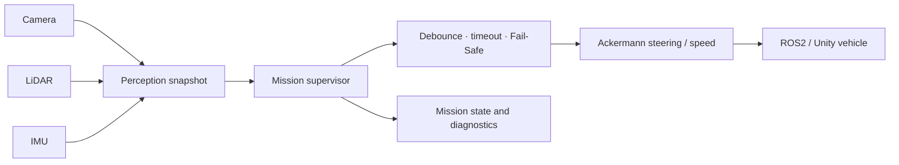
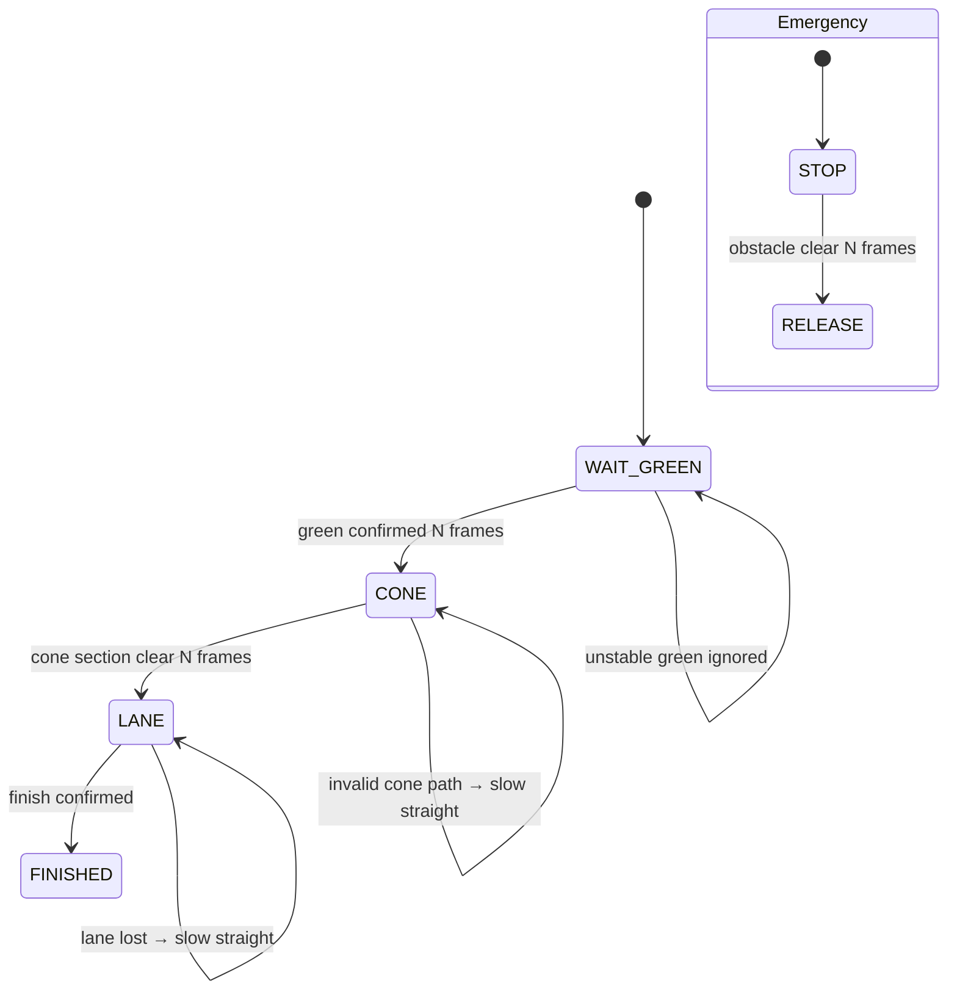

# 2026 국민대학교 자율주행 경진대회 — Mission Supervisor 재구성

[한국어](README.md) | [English](README.en.md)

> 성균관대학교 EMP 팀의 예선 자율주행 작업에서 확인한 시스템 통합 개념을 **hardware-independent mission supervisor**로 다시 구성한 저장소입니다. 실제 제출 ROS2 source나 팀 calibration 값은 포함하지 않습니다.

| 항목 | 내용 |
|---|---|
| 상태 | 2026 예선 참가 (대회 종료) |
| 원 시스템 | Camera/LiDAR/IMU → perception → mission planning → Ackermann control |
| 공개 코드 | 표준 Python만 사용하는 mission state machine과 unit test |
| 확인된 역할 문서 | ROS2 setup, `track_drive.py` framework, sensor integration, final integration/debugging |
| 기여 한계 | 원본 workspace에 Git·함수별 author 정보가 없어 단독 작성 주장 안 함 |

## 빠른 탐색

- [`src/mission_supervisor.py`](src/mission_supervisor.py): portable mission state machine
- [`tests/test_mission_supervisor.py`](tests/test_mission_supervisor.py): transition·Fail-Safe tests
- [`docs/provenance.md`](docs/provenance.md): 근거와 미확인 사실

## 1. 프로젝트 개요

로컬 팀 자료에서 확인된 예선 시스템은 신호등 출발, cone course, lane following, pedestrian/obstacle 대응, school-zone 제한과 mission 전환을 하나의 ROS2/Unity 주행 흐름으로 통합합니다. 다만 원본 폴더가 Git 저장소가 아니며 파일·함수별 작성자를 식별할 metadata가 없어, 이 저장소에는 팀 source 대신 핵심 통합 패턴을 새로 분리한 mission supervisor만 포함했습니다.

## 2. 전체 시스템 구조



### 재구성 state machine



## 3. Mission Supervisor 동작

| 상태 | 정상 동작 | 저하·안전 동작 |
|---|---|---|
| `WAIT_GREEN` | 연속 green 관측 후 출발 | 불연속 관측은 count reset |
| `CONE` | cone path error에 따라 제한 조향 | path invalid이면 저속 직진 |
| `LANE` | lane error 추종, school zone 감속 | lane lost이면 저속 직진 |
| `FINISHED` | speed 0, run 종료 | 계속 정지 |
| Emergency override | 모든 mission보다 우선 | 장애물 clear 연속 확인 후 해제 |

## 4. My Contribution과 근거

팀 planning 문서는 전자전기공학 전공 1인의 역할을 다음과 같이 기록합니다.

- ROS2 환경 구성
- `track_drive.py` framework
- sensor node integration
- 최종 integration과 debugging

그러나 이름·파일·함수를 연결하는 Git 기록이 없어 이를 제 단독 source 기여로 확정하지 않습니다. 이 저장소에서 commit으로 확인되는 개인 결과물은 원본 팀 code를 복사하지 않고 새로 작성한 [`MissionSupervisor`](src/mission_supervisor.py)와 tests입니다.

## 5. 주요 문제와 해결

| 문제 | 재구성에서의 해결 | Test |
|---|---|---|
| 한 frame 오검출로 mission이 바뀔 수 있음 | 연속 frame confirmation counter | green debounce test |
| 장애물이 사라진 순간 바로 재출발하면 위험 | clear distance를 여러 frame 확인 후 release | emergency release debounce test |
| lane이 잠시 사라지면 조향이 불안정 | 조향 0, 제한된 저속 straight fallback | lane-loss test |
| school zone과 일반 구간 속도 구분 | mission observation으로 speed cap | school-zone speed test |
| 팀 source의 소유 범위 불명확 | standard-library-only clean reconstruction | provenance 문서와 분리 저장 |

## 6. 실행 및 검증

```bash
python -m unittest discover -s tests -v
```

현재 tests는 다음을 확인합니다.

- green signal의 consecutive-frame confirmation
- lane-loss 시 slow straight fallback
- emergency stop release debounce
- school-zone speed cap

## 7. 상태

- 2026 국민대학교 자율주행 경진대회 예선(시뮬레이터 과제)에 팀으로 참가했습니다. 대회는 종료됐습니다.
- 이 저장소는 실제 제출 ROS2 package를 재현하거나 대체하지 않습니다.

## 8. 저장소 구조

```text
.
├─ src/
│  └─ mission_supervisor.py
├─ tests/
│  └─ test_mission_supervisor.py
├─ docs/
│  └─ provenance.md
├─ README.md
└─ README.en.md
```

## 9. 한계와 제외 범위

- 실제 perception, planning, control, ROS2 communication과 sensor timing을 포함하지 않습니다.
- 제출 source, exact tuning constant, organizer PDF·simulator asset, server key를 포함하지 않습니다.
- IP, 절대경로, log, video, calibration capture를 포함하지 않습니다.
- 재구성 test는 mission decision logic만 검증하며 실차·Unity 주행 성능을 입증하지 않습니다.

## 10. Attribution

원 시스템은 SKKU EMP 팀 공동 작업입니다. 이 저장소는 확인한 시스템 개념에서 파생한 개인 clean reconstruction이며 원본 팀 source의 저작권이나 단독 기여를 주장하지 않습니다. 실제 구현 공개는 대회 종료, 팀 동의와 함수별 기여 확인 이후에만 검토해야 합니다.
